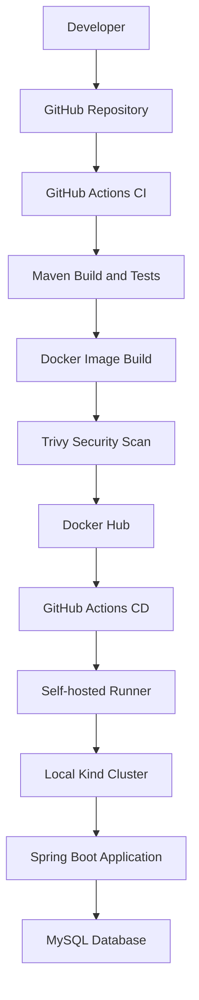

# AI-BankApp DevOps

**An end-to-end DevOps project demonstrating application containerization, Kubernetes deployment, CI/CD automation, and container security scanning.**

[](https://openjdk.org/)
[](https://spring.io/projects/spring-boot)
[](https://www.docker.com/)
[](https://kubernetes.io/)
[](https://github.com/features/actions)

**Developer:** [Rohini Divekar](https://github.com/Rohini-996)  
**Repository:** [AI-BankApp-DevOps](https://github.com/Rohini-996/AI-BankApp-DevOps)

---

## 1. Project Overview

AI-BankApp is a Spring Boot banking application used to demonstrate practical DevOps workflows, from building and testing application code to deploying containers on Kubernetes.

The project uses Docker for containerization, MySQL for data persistence, Kubernetes for orchestration, and GitHub Actions to automate CI/CD.

### Key objectives

- Containerize the application using Docker.
- Deploy the application and MySQL to Kubernetes.
- Automate build and test stages with GitHub Actions.
- Scan container images using Trivy.
- Publish versioned images to Docker Hub.
- Automate Kubernetes deployments using a self-hosted runner.

## 2. Architecture



### Workflow

1. Code is pushed to the `main` branch.
2. GitHub Actions builds and tests the application using Maven.
3. Docker builds an image tagged with the short Git commit SHA.
4. Trivy scans the image for critical and high-severity vulnerabilities.
5. If the checks pass, the image is published to Docker Hub.
6. The CD workflow deploys the matching image to the existing Kind cluster.
7. Kubernetes rollout status is checked to verify deployment progress.

**Deployment target:** Local Kind Kubernetes cluster accessed through a configured self-hosted GitHub Actions runner.

## 3. Technology Stack

| Technology | Purpose |
|---|---|
| Java 21, Spring Boot | Backend application |
| Maven | Build and testing |
| MySQL | Database |
| Docker, Docker Compose | Containerization and local environment |
| Kubernetes, Kind | Container orchestration and local cluster |
| Git, GitHub | Version control |
| GitHub Actions | CI/CD automation |
| Docker Hub | Container image registry |
| Trivy | Vulnerability scanning |
| Linux / Ubuntu | Development and runner environment |

## 4. Project Structure

```text
AI-BankApp-DevOps/
├── .github/
│   └── workflows/
│       ├── ci.yml
│       └── cd.yml
├── .mvn/wrapper/
├── k8s/
│   ├── namespace.yml
│   ├── configmap.yml
│   ├── secrets.yml
│   ├── pvc.yml
│   ├── mysql-deployment.yml
│   ├── bankapp-deployment.yml
│   └── service.yml
├── src/
├── Dockerfile
├── docker-compose.yml
├── mvnw
├── pom.xml
└── README.md
```

*Keep real credentials out of `k8s/secrets.yml` and never commit passwords or access tokens.*

## 5. Continuous Integration (CI)

The CI pipeline is defined in `.github/workflows/ci.yml`.

It automates the following stages:

- **Checkout:** Retrieve source code.
- **Build and test:** Run `./mvnw clean verify`.
- **Docker build:** Package the application into a container image.
- **Security scan:** Use Trivy to identify critical and high-severity vulnerabilities.
- **Image publishing:** Push the image to Docker Hub after successful checks.

### Image versioning

Images use a short Git commit SHA instead of relying on the mutable `latest` tag.

```text
<dockerhub-username>/ai-bankapp-devops:<short-commit-sha>
```

Configure these GitHub Actions repository secrets:

- `DOCKERHUB_USERNAME`
- `DOCKERHUB_TOKEN`

The CI workflow must log in to Docker Hub before pushing the image.

## 6. Continuous Deployment (CD)

The CD workflow is defined in `.github/workflows/cd.yml`.

After a successful CI run, it:

1. Checks out the corresponding source revision.
2. Determines the image tag from the commit SHA.
3. Verifies Kubernetes access.
4. Updates the existing `bankapp` Deployment in the `bankapp` namespace.
5. Waits for the rollout and checks pods and services.

Example deployment command:

```bash
kubectl set image deployment/bankapp \
  bankapp=<dockerhub-username>/ai-bankapp-devops:<short-commit-sha> \
  -n bankapp

kubectl rollout status deployment/bankapp -n bankapp
```

The self-hosted runner must have access to the intended Kind cluster. The CD pipeline updates an existing Deployment; it does not provision the cluster from scratch.

## 7. Kubernetes Deployment

The `k8s/` directory contains manifests for the application and database.

- `namespace.yml` — Application namespace.
- `configmap.yml` — Non-sensitive configuration.
- `pvc.yml` — Persistent storage request for MySQL.
- `mysql-deployment.yml` — Database workload.
- `bankapp-deployment.yml` — Spring Boot workload.
- `service.yml` — Kubernetes Services.
- `secrets.yml` — Local Secret configuration; keep credentials out of Git.

Check deployment status:

```bash
kubectl get pods -n bankapp
kubectl get deployments -n bankapp
kubectl get services -n bankapp
kubectl get pvc -n bankapp
```

View application logs:

```bash
kubectl logs deployment/bankapp -n bankapp
```

## 8. Run Locally with Docker Compose

Start the configured services:

```bash
docker compose up -d --build
```

Check running containers:

```bash
docker compose ps
```

View logs:

```bash
docker compose logs -f
```

Stop the services:

```bash
docker compose down
```

The available services depend on the current `docker-compose.yml` configuration.

## 9. Security and Reliability

This project demonstrates practical DevOps practices:

- Commit-based Docker image versioning for traceability.
- Automated build and test stages before image publishing.
- Trivy scanning for container vulnerabilities.
- Separation of application configuration from sensitive credentials.
- Kubernetes rollout verification after deployment.
- Persistent storage configuration for MySQL.

**Security note:** Kubernetes Secret values encoded in Base64 are not encrypted. Do not commit real credentials. If a credential has already been exposed, rotate it.

## 10. Troubleshooting

| Issue | What to check |
|---|---|
| Build failure | Java version, Maven output, and tests |
| Docker push failure | Docker Hub credentials and repository name |
| Pod not ready | Pod events, logs, and readiness probes |
| Database connection failure | MySQL service, credentials, and configuration |
| Image pull failure | Image name, tag, and registry access |
| CD deployment failure | Self-hosted runner, kubeconfig, and Kind status |

Useful commands:

```bash
kubectl get events -n bankapp --sort-by=.metadata.creationTimestamp
kubectl describe deployment bankapp -n bankapp
kubectl rollout history deployment/bankapp -n bankapp
```

## 11. Key Learnings

Through this project, I gained hands-on practice with:

- Docker containerization and multi-container environments.
- Kubernetes application and database deployment.
- GitHub Actions CI/CD pipeline design.
- Docker image versioning and registry publishing.
- Trivy-based container security scanning.
- Kubernetes rollout verification and troubleshooting.
- Managing application configuration and database secrets.

## 12. Future Improvements

- Strengthen automated integration and deployment smoke tests.
- Improve application monitoring and alerting.
- Add a documented rollback procedure.
- Integrate dedicated secret management.
- Explore deployment to managed cloud Kubernetes infrastructure.

These are planned improvements, not claims of existing implementation.

## About Me

**Rohini Divekar** — DevOps Fresher

I'm building practical skills in DevOps, containerization, Kubernetes, cloud infrastructure, and CI/CD automation through hands-on projects.

- **GitHub:** [Rohini-996](https://github.com/Rohini-996)
- **Project:** [AI-BankApp-DevOps](https://github.com/Rohini-996/AI-BankApp-DevOps)

*This project is intended for learning and demonstration. Production deployments require additional security, reliability, and operational controls.*
